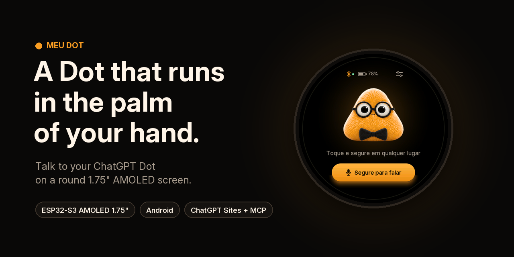
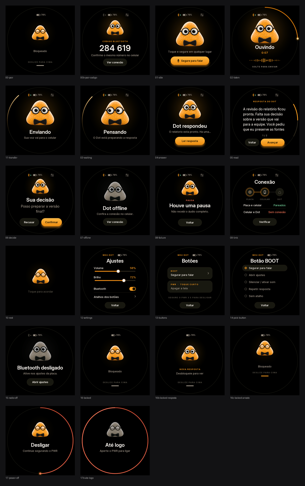
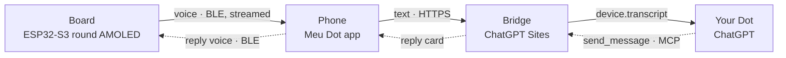

<p align="center">
  
</p>

<p align="center">
  <a href="https://github.com/Hellridergo/meu-dot/releases/latest"></a>
  
  
  
  <a href="LICENSE"></a>
  <a href="https://www.linkedin.com/in/leonardocandidosiqueira/"></a>
</p>

<p align="center">
  <b>English</b> · <a href="README.pt-BR.md">Português</a>
</p>

**Meu Dot** turns a round AMOLED board into a pocket companion for your **ChatGPT Dot**. Hold the character, speak, and let go. Your voice travels over Bluetooth to your phone, becomes text, and reaches your Dot conversation as an event. The Dot's answer comes back as a card on the round screen and is read aloud by the board's speaker, while the character's mouth moves with the voice.

> [!NOTE]
> Meu Dot is an independent hobby project. It is not affiliated with, endorsed by or sponsored by OpenAI or Waveshare. "ChatGPT" and "Dot" refer to the OpenAI services this project connects to.

<p align="center">
  
</p>

## What it does

- **Hold to talk.** Hold the character, or the BOOT button, for up to 30 s. Swipe up while you are recording to discard it.
- **Fast round trip.** The board streams your voice while you speak, so the full recording reaches the phone about 15 ms after you release. Once the Dot has answered, its voice starts in under a second.
- **Answers and decisions.** Long answers are split into pages. When the Dot asks for a decision, the board shows Confirm and Decline buttons, and your choice goes back to the same conversation.
- **A character that reacts.** The amber Dot has 27 frames for blinking, looking around and talking, and its mouth follows the level of the reply audio.
- **Made for the pocket.** The screen dims after 15 s and locks after 30 s; swipe up to unlock. A short PWR press turns the screen off, and holding PWR for 3 s powers the board off. The screen shows the battery level and charging state.
- **Your choice of voice.** Speech recognition runs either on the phone with Whisper (offline) or on Gemini. The reply can be read by the offline Android voice, Gemini TTS or Fish Audio. API keys are encrypted with the Android Keystore and never leave the phone except to the provider you picked.

## How it works



1. **Board.** The firmware records 16 kHz audio and streams it over Bluetooth LE notifications while you speak.
2. **Phone.** The app transcribes the recording and sends the text to your bridge over HTTPS.
3. **Bridge.** It stores the text and delivers a signed `device.transcript` event to the Dot conversation that subscribed to it. The bridge is a small site hosted on ChatGPT Sites, and only your ChatGPT account can open its panel.
4. **Dot.** It answers with the MCP tools `send_message` or `ask_confirmation`.
5. **Back to the board.** The phone picks up the reply, synthesizes it and streams the audio back. The board starts playing once it has 1 s of audio buffered.

Read [How it works](docs/en/how-it-works.md) for the architecture, the Bluetooth protocol and the latency measurements.

## What you need

| Item | Notes |
| --- | --- |
| [Waveshare ESP32-S3-Touch-AMOLED-1.75C](https://docs.waveshare.com/ESP32-S3-Touch-AMOLED-1.75C) | 1.75" 466×466 AMOLED, ESP32-S3R8, two microphones, built-in speaker and an aluminium case. It comes with a battery (SKU 33691) or without one (SKU 33692). |
| 3.7 V Li-ion battery (optional) | MX1.25 2-pin connector. You only need one if you bought the board without a battery. |
| USB-C data cable | Used to install the firmware. |
| Android phone | Android 12 or newer, ARM64, with Bluetooth LE. |
| ChatGPT account | Needs access to **Dot conversations**, **custom MCP plugins** and **ChatGPT Sites**. Availability depends on your plan and region. |
| Optional API keys | Gemini (speech-to-text and/or text-to-speech) or Fish Audio (text-to-speech). Whisper and the offline Android voice need no key. |

## Quick start

1. **Flash the board.** Use the [web installer](https://hellridergo.github.io/meu-dot/flasher/) in Chrome or Edge, or run `esptool` with the full image from [Releases](https://github.com/Hellridergo/meu-dot/releases/latest).
2. **Install the app.** Download `meu-dot-android-0.5.4.apk` from Releases and install it on the phone.
3. **Deploy your bridge** on ChatGPT Sites from the [`bridge/`](bridge) folder and set its four secrets.
4. **Connect your Dot.** Enable the bridge plugin in your Dot conversation and paste the instruction shown in the bridge panel.
5. **Pair and talk.** Pair the phone with the board (the board shows a 6-digit code), paste the bridge URL and token into the app, then hold the character and say *"Reply only with: pineapple"*.

The [step-by-step guide](docs/en/getting-started.md) covers every click and assumes no prior experience with ESP32 or Android development.

## Measured latency

Measured on a Galaxy S25 Ultra with the same phrase and the same network, using the app's own timing log. Version 0.5 keeps the same protocol and adds a short buffer before playback, so that replies do not cut out.

| Step | 0.3 (before) | 0.4.4 (after) |
| --- | ---: | ---: |
| Release → voice fully on the phone | several seconds | **~15 ms** |
| Reply on the phone → first sound | 6 to 35 s, growing with the reply length | **0.45 to 0.78 s** |
| Release → first sound | 30.0 s | **~22 s** |

Most of the remaining time is the Dot thinking (19 to 23 s). Next on the roadmap: transcribing while you speak.

## Repository layout

```
firmware/     ESP-IDF 5.5.5 project for the board (C)
interface/    Screen compositor shared by the firmware and the simulator (C)
android/      Android app, plain Java plus a whisper.cpp JNI library (no Gradle)
bridge/       Bridge for ChatGPT Sites (Next.js on Workers, D1, R2, MCP)
art/          Character sheets, colour direction and the Inter font
tools/        Art pipeline, simulator build and repository assets
tests/        Host tests: firmware audio (ASan/UBSan), gestures, battery, Android contracts
docs/         Guides in English and Portuguese, images, simulator and web installer
```

## Documentation

| | English | Português |
| --- | --- | --- |
| Step-by-step setup | [Getting started](docs/en/getting-started.md) | [Primeiros passos](docs/pt-BR/primeiros-passos.md) |
| Architecture and protocol | [How it works](docs/en/how-it-works.md) | [Como funciona](docs/pt-BR/como-funciona.md) |
| Bridge on ChatGPT Sites | [Bridge](docs/en/bridge.md) | [Ponte](docs/pt-BR/ponte.md) |
| Building from source | [Building](docs/en/building.md) | [Compilar](docs/pt-BR/compilar.md) |
| Fixing problems | [Troubleshooting](docs/en/troubleshooting.md) | [Solução de problemas](docs/pt-BR/solucao-de-problemas.md) |

You can also try the round screen in the browser with the [interactive simulator](https://hellridergo.github.io/meu-dot/simulator/).

## Roadmap

- [ ] Transcribe while you speak, to remove the 1.4 to 6 s of transcription after release.
- [ ] Open the text-to-speech connection while the Dot is still thinking.
- [ ] Optional vibration motor for new replies. The firmware is ready; it needs a small transistor circuit.
- [ ] A bridge that can be self-hosted outside ChatGPT Sites.
- [ ] Continuous integration that builds the firmware and APK on every release.

## Author

Meu Dot is a project by **Leo Candido**. If you build your own, share it: I'd love to see it.

<p>
  <a href="https://www.linkedin.com/in/leonardocandidosiqueira/"></a>
  <a href="https://github.com/Hellridergo"></a>
</p>

## Credits

- Inspired by [rsms/esp32-dot](https://github.com/rsms/esp32-dot), which first put a ChatGPT Dot on a Waveshare board.
- Built on [ESP-IDF](https://github.com/espressif/esp-idf), [LVGL](https://lvgl.io), the [Waveshare BSP](https://github.com/waveshareteam/ESP32-S3-Touch-AMOLED-1.75C), [whisper.cpp](https://github.com/ggml-org/whisper.cpp) and the [Inter](https://rsms.me/inter/) typeface. See [THIRD-PARTY-NOTICES.md](THIRD-PARTY-NOTICES.md).

## License

The code is released under the [MIT License](LICENSE). The character art in [`art/`](art) has its own license, described in [art/LICENSE.md](art/LICENSE.md).
