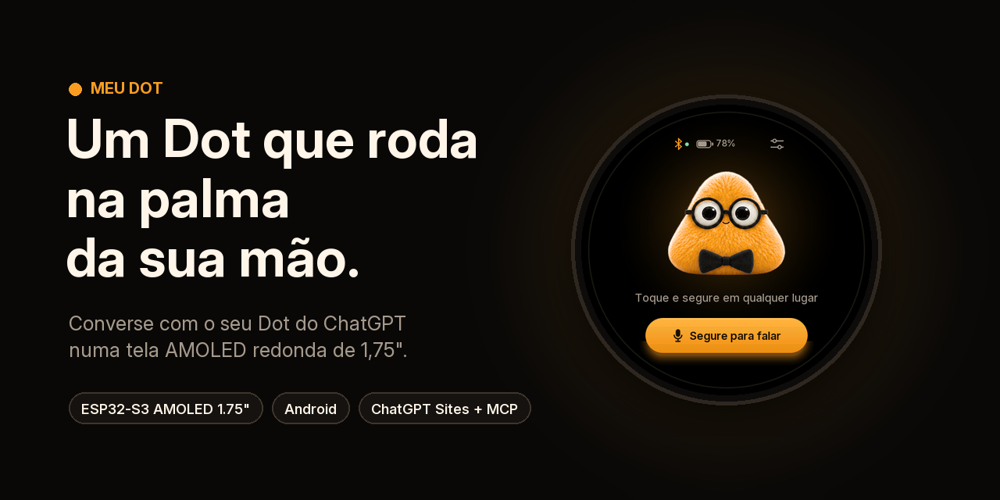
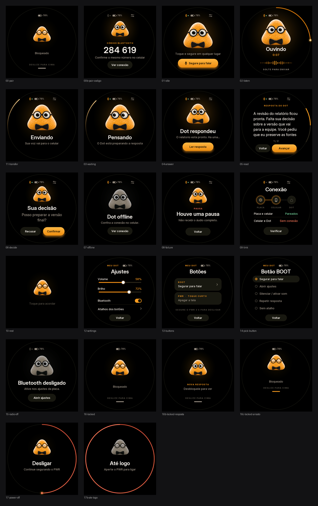
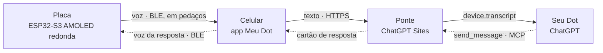

<p align="center">
  
</p>

<p align="center">
  <a href="https://github.com/Hellridergo/meu-dot/releases/latest"></a>
  
  
  
  <a href="LICENSE"></a>
  <a href="https://www.linkedin.com/in/leonardocandidosiqueira/"></a>
</p>

<p align="center">
  <a href="README.md">English</a> · <b>Português</b>
</p>

O **Meu Dot** transforma uma placa com tela AMOLED redonda num companheiro para o seu **Dot do ChatGPT** que roda na palma da sua mão. Você segura o personagem, fala e solta. A voz vai pelo Bluetooth até o celular, vira texto e chega à conversa do seu Dot como um evento. A resposta volta como um cartão na tela redonda e é lida em voz alta pelo alto-falante da placa, enquanto a boca do personagem acompanha a voz.

> [!NOTE]
> O Meu Dot é um projeto pessoal e independente, sem vínculo, endosso ou patrocínio da OpenAI ou da Waveshare. "ChatGPT" e "Dot" se referem aos serviços da OpenAI aos quais o projeto se conecta.

<p align="center">
  
</p>

## O que ele faz

- **Segure para falar.** Segure o personagem ou o botão BOOT por até 30 s. Para descartar uma gravação, deslize para cima enquanto grava.
- **Ida e volta rápidas.** A fala vai para o celular enquanto você ainda está falando. Por isso, a gravação inteira chega cerca de 15 ms depois de soltar. Depois que o Dot responde, a voz começa em menos de 1 segundo.
- **Respostas e decisões.** Respostas longas aparecem em páginas. Quando o Dot pede uma decisão, a tela mostra os botões Confirmar e Recusar, e sua escolha volta para a mesma conversa.
- **Personagem que reage.** O Dot âmbar tem 27 quadros de piscada, olhar e fala. A boca segue o volume da voz da resposta.
- **Feito para levar com você.**
  - A tela escurece aos 15 s, bloqueia aos 30 s e desbloqueia com um deslizar para cima.
  - Um toque curto no PWR apaga a tela, e segurar o PWR por 3 s desliga a placa.
  - A tela mostra a bateria e o carregamento.
- **Você escolhe a voz.**
  - A transcrição acontece no próprio celular, com o Whisper offline, ou no Gemini.
  - A resposta pode ser lida pela voz offline do Android, pelo Gemini TTS ou pela Fish Audio.
  - As chaves de API ficam cifradas no Android Keystore e só saem do celular para o provedor que você escolheu.

## Como funciona



1. **Placa.** O firmware grava a 16 kHz e envia o áudio por notificações Bluetooth LE enquanto você fala.
2. **Celular.** O app transcreve a gravação e manda o texto à sua ponte por HTTPS.
3. **Ponte.** É um pequeno site no ChatGPT Sites, cujo painel só abre com a sua conta do ChatGPT. Ela guarda o texto e entrega um evento assinado `device.transcript` à conversa do Dot que o assinou.
4. **Dot.** Ele responde com as ferramentas MCP `send_message` ou `ask_confirmation`.
5. **Volta à placa.** O celular busca a resposta, sintetiza a voz e a envia em pedaços. A placa começa a tocar assim que tem 1 s de áudio guardado.

A arquitetura, o protocolo Bluetooth e as medições estão em [Como funciona](docs/pt-BR/como-funciona.md).

## O que você precisa

| Item | Observações |
| --- | --- |
| [Waveshare ESP32-S3-Touch-AMOLED-1.75C](https://docs.waveshare.com/ESP32-S3-Touch-AMOLED-1.75C) | AMOLED de 1,75" com 466×466, ESP32-S3R8, dois microfones, alto-falante embutido e case de alumínio. É vendida com bateria (SKU 33691) ou sem (SKU 33692). |
| Bateria Li-ion de 3,7 V (opcional) | Conector MX1.25 de 2 pinos. Só é necessária se você comprou a versão sem bateria. |
| Cabo USB-C de dados | Para gravar o firmware. |
| Celular Android | Android 12 ou superior, ARM64, com Bluetooth LE. |
| Conta do ChatGPT | Precisa de acesso a **conversas com Dot**, **plugins MCP personalizados** e **ChatGPT Sites**. A disponibilidade depende do plano e da região. |
| Chaves de API (opcional) | Gemini (transcrição e/ou voz) ou Fish Audio (voz). O Whisper e a voz offline do Android não precisam de chave. |

## Começo rápido

1. **Grave o firmware.** Use o [instalador pelo navegador](https://hellridergo.github.io/meu-dot/flasher/) no Chrome ou no Edge, ou o `esptool` com a imagem completa das [Releases](https://github.com/Hellridergo/meu-dot/releases/latest).
2. **Instale o app.** Baixe o `meu-dot-android-0.5.4.apk` das Releases e instale no celular.
3. **Publique sua ponte** no ChatGPT Sites a partir da pasta [`bridge/`](bridge) e configure os quatro segredos.
4. **Conecte o seu Dot.** Ative o plugin da ponte na conversa do Dot e cole a instrução que aparece no painel da ponte.
5. **Pareie e fale.** Pareie o celular com a placa (ela mostra um código de 6 dígitos) e cole no app o endereço e o token da ponte. Depois segure o personagem e diga *"Responda apenas jabuticaba"*.

O [guia passo a passo](docs/pt-BR/primeiros-passos.md) mostra cada clique e não exige experiência com ESP32 ou com desenvolvimento Android.

## Latência medida

Medido num Galaxy S25 Ultra, com a mesma frase e a mesma rede, pelo registro de tempos do próprio app. A versão 0.5 mantém o mesmo protocolo e acrescenta uma pequena reserva antes de tocar, para a resposta não cortar.

| Etapa | 0.3 (antes) | 0.4.4 (depois) |
| --- | ---: | ---: |
| Soltar → fala inteira no celular | vários segundos | **~15 ms** |
| Resposta no celular → primeiro som | 6 a 35 s, crescendo com o tamanho da resposta | **0,45 a 0,78 s** |
| Soltar → primeiro som | 30,0 s | **~22 s** |

A maior parte do tempo que sobra é o Dot pensando (19 a 23 s). O próximo passo do roteiro é transcrever enquanto você fala.

## Organização do repositório

```
firmware/     Projeto ESP-IDF 5.5.5 da placa (C)
interface/    Compositor da tela, usado pelo firmware e pelo simulador (C)
android/      App Android em Java puro, com biblioteca JNI do whisper.cpp (sem Gradle)
bridge/       Ponte para o ChatGPT Sites (Next.js em Workers, D1, R2, MCP)
art/          Folhas do personagem, direção de cores e a fonte Inter
tools/        Pipeline de arte, simulador e imagens do repositório
tests/        Testes no computador: áudio do firmware (ASan/UBSan), gestos, bateria e contratos do app
docs/         Guias em inglês e português, imagens, simulador e instalador web
```

## Documentação

| | Português | English |
| --- | --- | --- |
| Montagem passo a passo | [Primeiros passos](docs/pt-BR/primeiros-passos.md) | [Getting started](docs/en/getting-started.md) |
| Arquitetura e protocolo | [Como funciona](docs/pt-BR/como-funciona.md) | [How it works](docs/en/how-it-works.md) |
| Ponte no ChatGPT Sites | [Ponte](docs/pt-BR/ponte.md) | [Bridge](docs/en/bridge.md) |
| Compilar a partir do código | [Compilar](docs/pt-BR/compilar.md) | [Building](docs/en/building.md) |
| Resolver problemas | [Solução de problemas](docs/pt-BR/solucao-de-problemas.md) | [Troubleshooting](docs/en/troubleshooting.md) |

Você também pode experimentar a tela redonda no navegador, com o [simulador interativo](https://hellridergo.github.io/meu-dot/simulator/).

## Próximos passos

- [ ] Transcrever enquanto você fala, eliminando os 1,4 a 6 s de transcrição depois de soltar.
- [ ] Abrir a conexão da voz enquanto o Dot ainda pensa.
- [ ] Motor de vibração opcional para novas respostas. O firmware está pronto; falta um pequeno circuito com transistor.
- [ ] Uma ponte que rode fora do ChatGPT Sites.
- [ ] Integração contínua que compile o firmware e o APK a cada versão.

## Autor

O Meu Dot é um projeto de **Leo Candido**. Se você montar o seu, compartilhe: vou adorar ver.

<p>
  <a href="https://www.linkedin.com/in/leonardocandidosiqueira/"></a>
  <a href="https://github.com/Hellridergo"></a>
</p>

## Créditos

- Inspirado no [rsms/esp32-dot](https://github.com/rsms/esp32-dot), que colocou pela primeira vez um Dot do ChatGPT numa placa Waveshare.
- Construído com o [ESP-IDF](https://github.com/espressif/esp-idf), o [LVGL](https://lvgl.io), o [BSP da Waveshare](https://github.com/waveshareteam/ESP32-S3-Touch-AMOLED-1.75C), o [whisper.cpp](https://github.com/ggml-org/whisper.cpp) e a fonte [Inter](https://rsms.me/inter/). Veja [THIRD-PARTY-NOTICES.md](THIRD-PARTY-NOTICES.md).

## Licença

O código está sob a [licença MIT](LICENSE). A arte do personagem, em [`art/`](art), tem licença própria, descrita em [art/LICENSE.md](art/LICENSE.md).
