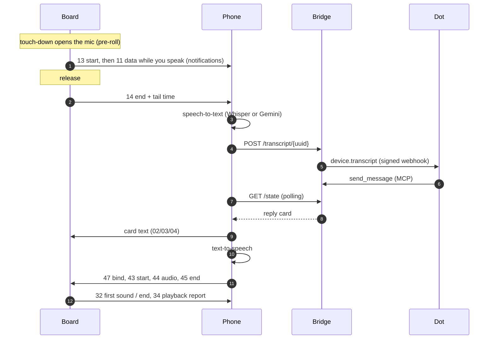

# How it works

Meu Dot has three parts that talk to each other:

| Part | Runs on | Code |
| --- | --- | --- |
| **Board** | Waveshare ESP32-S3-Touch-AMOLED-1.75C, with ESP-IDF 5.5.5 and FreeRTOS | [`firmware/`](../../firmware), [`interface/`](../../interface) |
| **Phone** | Android 12+ ARM64, as a foreground service plus the app UI | [`android/`](../../android) |
| **Bridge** | ChatGPT Sites (Workers, D1, R2, MCP) | [`bridge/`](../../bridge) |

The board never touches the internet. It only speaks Bluetooth LE to the phone. The phone holds the API keys and the bridge token, and the bridge is the only part your Dot can reach.

## One request, end to end

## Board firmware

- **Audio.** Microphone and speaker run at 16 kHz mono, sent over the air as 8-bit G.711 µ-law, which is 16 KB/s. The ES7210 handles the microphones and the ES8311 the speaker.
- **Recording.**
  - Touching the screen opens the microphone straight away. If the touch turns into a 260 ms hold, the recording keeps the audio from touch-down, so the first syllable survives. Otherwise it is dropped silently.
  - After 0.25 s of speech a separate task (`dot_uplink`) starts sending the audio while you keep talking. The capture loop never waits for the radio.
- **Playback.**
  - The reply arrives in pieces and plays once enough is buffered: 0.2 s normally, or 1 s if the audio arrives slower than 1.25× real time.
  - After an underrun the board waits for 1.5 s of audio before resuming, so a slow stretch becomes one pause instead of a series of cuts.
  - The audio task runs at priority 8, above LVGL (6), because the I2S DMA only holds about 90 ms.
- **Screen.**
  - [`interface/dot_ui.c`](../../interface/dot_ui.c) is a small compositor that owns every screen, gesture and animation.
  - It redraws and sends to the panel only the areas that changed. A full frame costs about 65 ms on the panel; a typical partial repaint averages 0.45 ms.
  - The same file compiles to WebAssembly for the [simulator](../simulator/index.html).
- **Power.** The AXP2101 is read every 5 s, without changing any charger setting. Holding PWR for 3 s asks the AXP2101 to power off.
- **Logs.** The USB console shows `dot_ble` (connection, disconnect reasons), `dot_audio` (pauses and speaker faults per reply), `dot_tempo` (release to first sound) and `dot_ui` (paint time).

## Phone app

- **`Companion`** is a foreground service. It keeps the Bluetooth link, polls the bridge every 550 ms while waiting for a reply (2.5 s after 45 s, 6 s when idle), and runs speech-to-text and text-to-speech.
- **Speech-to-text.** Choose between [whisper.cpp](https://github.com/ggml-org/whisper.cpp) on the phone (`base` q5_1 model, downloaded once, SHA-256 checked) and Gemini.
- **Text-to-speech.** Choose between the Android voice, Gemini (SSE streaming) and Fish Audio (WebSocket). The phone opens the speaker stream only once it has 1 s of speech, or the whole reply if it is shorter, because cloud voices often send the first words early and then pause.
- **Pacing.** Reply audio is written without response, but paced: 1 s ahead, then at most 2.5× real time. A flood of writes used to starve the board and drop the link.
- **Keys.** Gemini and Fish keys and the bridge token are encrypted with an AES-GCM key from the Android Keystore.
- **Logs.** `adb logcat -s MeuDotBle MeuDotTiming MeuDotVoz` shows link events, the timing of every step and voice fallbacks.

## Bluetooth LE protocol

The board is a GATT peripheral. Pairing uses LE Secure Connections with a 6-digit passkey shown on the board (MITM protection), and every write requires an authenticated, encrypted link.

| UUID | Role |
| --- | --- |
| `64f10000-5ac2-4d32-a6ea-2c940d0487ab` | Service |
| `64f10001-5ac2-4d32-a6ea-2c940d0487ab` | **RX**: phone → board. Write, and write without response. |
| `64f10002-5ac2-4d32-a6ea-2c940d0487ab` | **TX**: board → phone. Indicate and notify. |

The first byte of every packet is the opcode. Multi-byte numbers are little-endian.

### Capability negotiation

1. After the phone subscribes, the board sends `30 01` (it accepts reply audio in pieces) and `35 01 <flags>`. The flags are: bit 0, playback events; bit 1, reserved; bit 2, fast link.
2. A phone that understands the fast-link bit rewrites the TX CCC to `03 00`, which enables notifications as well as indications, and answers `08 01`.
3. From then on, the microphone is streamed by notification and reply audio is written without response.
4. Older phones and boards ignore the opcodes they do not know and keep the previous framing.

### Phone → board (RX)

| Op | Payload | Meaning |
| --- | --- | --- |
| `01` | `online:u8` | Bridge reachable or not. |
| `02` | `kind:u8 tag:u32 len:u16` | Card header. Kind is `0` notice, `1` decision, `2` error. |
| `03` | UTF-8 bytes | Card text, in parts. |
| `04` | — | Card end. |
| `07` | — | Recording delivered to the bridge. |
| `08` | `01` | Accepts the microphone while it records. |
| `40` / `41` / `42` | `len:u32` / µ-law / — | Reply audio, legacy framing: the size is known up front. |
| `43` / `44` / `45` | — / µ-law / — | Reply audio in pieces: start, data, end. |
| `46` | — | Cancel the reply audio. |
| `47` | `tag:u32 recording:u32` | Links the next reply to a recording, for the release-to-sound measure. |

### Board → phone (TX)

| Op | Payload | Meaning |
| --- | --- | --- |
| `10` / `11` / `12` | `len:u32 id:u32` / `seq:u16` µ-law / `id:u32` | Microphone, legacy framing: sent after release. |
| `13` / `11` / `14` | `id:u32` / `seq:u16` µ-law / `id:u32 total:u32 tail_ms:u16` | Microphone in pieces, while recording. |
| `16` | `id:u32` | Recording discarded. |
| `21` | `action:u8 tag:u32` | Choice on a card: dismiss, confirm or decline. |
| `30` | `01` | Capability: reply audio in pieces. |
| `31` | `01 flags:u8 percent:u8` | Battery state. |
| `32` | `kind:u8 tag:u32 elapsed_ms:u32` | Playback event: `1` first sound, `2` end, `3` cancelled. |
| `34` | `recv:u16 played:u16 faults:u8 fault_ms:u16 pauses:u8 pause_ms:u16 gap:u8` | Report on the reply just played, in ms. |
| `35` | `01 flags:u8` | Capabilities (see above). |

## Where the time goes

Measured on a Galaxy S25 Ultra with app 0.4.4, board firmware 0.4.4 and a short phrase. The board protocol is the same as in 0.5.4.

| Step | Time |
| --- | ---: |
| Release → full recording on the phone | ~15 ms |
| Transcription (Gemini, short phrase) | 1.4 to 1.8 s |
| Sending to the bridge | 0.3 to 0.4 s |
| **Your Dot thinking and answering** | **19 to 23 s** |
| Reply on the phone → first synthesized audio | 0.2 to 0.75 s |
| First Bluetooth packet → first sound | 0.15 to 0.49 s |
| **Release → first sound** | **~22 s** |

Before the fast-link work (0.3), the recording only started to travel after you released it, at 2 to 8 KB/s against the 16 KB/s the audio needs. The reply also had to arrive in full before it could play, so the wait grew with its length: 35 s for an 11 s reply. Today the time is dominated by the Dot itself.

## Visual direction

The Lume direction uses the Dot as the light source of the interface:

- true black for the AMOLED;
- a warm halo behind the character;
- amber `#F99D22` as the single accent;
- green `#7FDCA4` only for connection and coral `#FF7B5E` only for failures.

The amber character is produced from the original blue art by [`tools/ambar.py`](../../tools/ambar.py), which recolours only the fur in OKLab. [`tools/recursos.py`](../../tools/recursos.py) then converts every pose to premultiplied RGB565 plus a 4-bit mask for the firmware. See [`art/DIRECAO.txt`](../../art/DIRECAO.txt).
