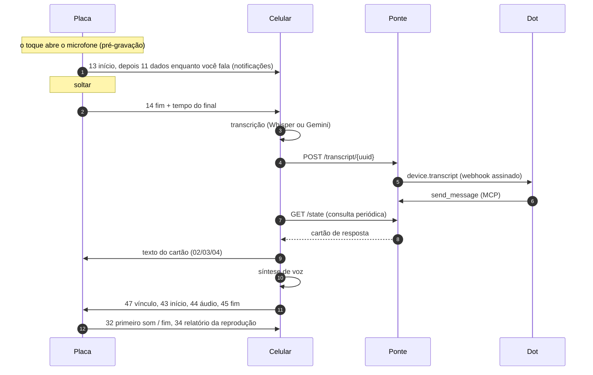

# Como funciona

O Meu Dot tem três partes que conversam entre si:

| Parte | Onde roda | Código |
| --- | --- | --- |
| **Placa** | Waveshare ESP32-S3-Touch-AMOLED-1.75C, com ESP-IDF 5.5.5 e FreeRTOS | [`firmware/`](../../firmware), [`interface/`](../../interface) |
| **Celular** | Android 12+ ARM64, como serviço em primeiro plano e interface do app | [`android/`](../../android) |
| **Ponte** | ChatGPT Sites (Workers, D1, R2, MCP) | [`bridge/`](../../bridge) |

A placa nunca acessa a internet. Ela só fala Bluetooth LE com o celular. O celular guarda as chaves de API e o token da ponte, e a ponte é a única parte que o seu Dot alcança.

## Um pedido, do começo ao fim

## Firmware da placa

- **Áudio.** O microfone e o alto-falante trabalham a 16 kHz mono. O áudio viaja como µ-law G.711 de 8 bits, ou seja, 16 KB/s. O ES7210 cuida dos microfones e o ES8311 do alto-falante.
- **Gravação.**
  - O toque na tela já abre o microfone. Se o toque vira um segurar de 260 ms, a gravação guarda o áudio desde o toque, e a primeira sílaba não se perde. Se não vira, o áudio é descartado em silêncio.
  - Depois de 0,25 s de fala, uma tarefa separada (`dot_uplink`) começa a enviar o áudio enquanto você continua falando. A captura nunca espera o rádio.
- **Reprodução.**
  - A resposta chega em pedaços e toca assim que há reserva suficiente: 0,2 s normalmente, ou 1 s se o áudio estiver chegando mais devagar que 1,25 vez o tempo real.
  - Depois de uma falta de dados, a placa espera 1,5 s de áudio antes de voltar a tocar. Assim, um trecho lento vira uma única pausa, e não uma série de cortes.
  - A tarefa de áudio tem prioridade 8, acima do LVGL (6), porque o DMA do I2S guarda só uns 90 ms.
- **Tela.**
  - O [`interface/dot_ui.c`](../../interface/dot_ui.c) é um pequeno compositor que cuida de todas as telas, gestos e animações.
  - Ele redesenha e envia ao painel só as áreas que mudaram. Um quadro inteiro custa uns 65 ms no painel; uma repintura parcial típica leva em média 0,45 ms.
  - O mesmo arquivo compila para WebAssembly no [simulador](../simulator/index.html).
- **Energia.** O AXP2101 é lido a cada 5 s, sem mudar nenhuma configuração do carregador. Segurar o PWR por 3 s pede ao AXP2101 que desligue.
- **Registros.** O console USB mostra:
  - `dot_ble`: conexão e motivo de cada desconexão;
  - `dot_audio`: pausas e falhas do alto-falante em cada resposta;
  - `dot_tempo`: tempo de soltar até o primeiro som;
  - `dot_ui`: tempo de pintura.

## App do celular

- **`Companion`** é um serviço em primeiro plano. Ele mantém o Bluetooth e roda a transcrição e a síntese de voz. Enquanto espera uma resposta, consulta a ponte a cada 550 ms; depois de 45 s, a cada 2,5 s; parado, a cada 6 s.
- **Transcrição.** Você escolhe entre o [whisper.cpp](https://github.com/ggml-org/whisper.cpp) no celular (modelo `base` q5_1, baixado uma vez e conferido por SHA-256) e o Gemini.
- **Síntese de voz.** Você escolhe entre a voz do Android, o Gemini (streaming SSE) e a Fish Audio (WebSocket). O celular só abre o envio da voz quando tem 1 s de fala pronta, ou a resposta inteira se ela for mais curta, porque as vozes em nuvem costumam mandar as primeiras palavras antes do resto.
- **Ritmo.** A voz da resposta vai por escrita sem confirmação, mas em ritmo controlado: 1 s de folga e depois no máximo 2,5 vezes o tempo real. Antes, a enxurrada de pacotes travava a placa e derrubava a conexão.
- **Chaves.** As chaves do Gemini e da Fish e o token da ponte ficam cifrados com uma chave AES-GCM do Android Keystore.
- **Registros.** `adb logcat -s MeuDotBle MeuDotTiming MeuDotVoz` mostra os eventos do link, o tempo de cada etapa e as trocas de voz.

## Protocolo Bluetooth LE

A placa é um periférico GATT. O pareamento usa LE Secure Connections com um código de 6 dígitos mostrado na placa (proteção contra MITM), e toda escrita exige um link cifrado e autenticado.

| UUID | Papel |
| --- | --- |
| `64f10000-5ac2-4d32-a6ea-2c940d0487ab` | Serviço |
| `64f10001-5ac2-4d32-a6ea-2c940d0487ab` | **RX**: celular → placa. Escrita, com e sem resposta. |
| `64f10002-5ac2-4d32-a6ea-2c940d0487ab` | **TX**: placa → celular. Indicação e notificação. |

O primeiro byte de todo pacote é o código da operação. Números com mais de um byte são little-endian.

### Negociação de recursos

1. Depois que o celular assina o TX, a placa envia `30 01` (aceita a voz da resposta em pedaços) e `35 01 <flags>`. Os bits são: 0, eventos de reprodução; 1, reservado; 2, link rápido.
2. O celular que entende o bit do link rápido regrava o CCC do TX com `03 00`, ativando notificações além de indicações, e responde `08 01`.
3. Daí em diante, o microfone vai por notificação e a voz da resposta vai por escrita sem confirmação.
4. Celulares e placas antigos ignoram os códigos que não conhecem e continuam com o formato anterior.

### Celular → placa (RX)

| Op | Conteúdo | Significado |
| --- | --- | --- |
| `01` | `online:u8` | A ponte está ou não acessível. |
| `02` | `kind:u8 tag:u32 len:u16` | Cabeçalho do cartão. Tipo `0` aviso, `1` decisão, `2` erro. |
| `03` | bytes UTF-8 | Texto do cartão, em partes. |
| `04` | — | Fim do cartão. |
| `07` | — | Gravação entregue à ponte. |
| `08` | `01` | Aceita o microfone durante a gravação. |
| `40` / `41` / `42` | `len:u32` / µ-law / — | Voz da resposta no formato antigo: o tamanho vai antes. |
| `43` / `44` / `45` | — / µ-law / — | Voz da resposta em pedaços: início, dados e fim. |
| `46` | — | Cancela a voz da resposta. |
| `47` | `tag:u32 recording:u32` | Liga a próxima resposta a uma gravação, para medir de soltar até o som. |

### Placa → celular (TX)

| Op | Conteúdo | Significado |
| --- | --- | --- |
| `10` / `11` / `12` | `len:u32 id:u32` / `seq:u16` µ-law / `id:u32` | Microfone no formato antigo: enviado depois de soltar. |
| `13` / `11` / `14` | `id:u32` / `seq:u16` µ-law / `id:u32 total:u32 tail_ms:u16` | Microfone em pedaços, durante a gravação. |
| `16` | `id:u32` | Gravação descartada. |
| `21` | `action:u8 tag:u32` | Escolha num cartão: dispensar, confirmar ou recusar. |
| `30` | `01` | Recurso: voz da resposta em pedaços. |
| `31` | `01 flags:u8 percent:u8` | Estado da bateria. |
| `32` | `kind:u8 tag:u32 elapsed_ms:u32` | Evento de reprodução: `1` primeiro som, `2` fim, `3` cancelado. |
| `34` | `recv:u16 played:u16 faults:u8 fault_ms:u16 pauses:u8 pause_ms:u16 gap:u8` | Relatório da resposta que acabou de tocar, em ms. |
| `35` | `01 flags:u8` | Recursos (veja acima). |

## Para onde vai o tempo

Medido num Galaxy S25 Ultra com o app 0.4.4, o firmware 0.4.4 e uma frase curta. O protocolo da placa é o mesmo da 0.5.4.

| Etapa | Tempo |
| --- | ---: |
| Soltar → gravação inteira no celular | ~15 ms |
| Transcrição (Gemini, frase curta) | 1,4 a 1,8 s |
| Envio à ponte | 0,3 a 0,4 s |
| **Seu Dot pensando e respondendo** | **19 a 23 s** |
| Resposta no celular → primeiro áudio sintetizado | 0,2 a 0,75 s |
| Primeiro pacote Bluetooth → primeiro som | 0,15 a 0,49 s |
| **Soltar → primeiro som** | **~22 s** |

Antes do trabalho no Bluetooth (0.3), a gravação só começava a viajar depois de soltar, a 2 a 8 KB/s, contra os 16 KB/s de que o áudio precisa. A resposta também tinha de chegar inteira antes de tocar, então a espera crescia com o tamanho dela: 35 s para uma resposta de 11 s. Hoje quem domina o tempo é o próprio Dot.

## Direção visual

A direção Lume usa o Dot como a fonte de luz da interface:

- preto verdadeiro no AMOLED;
- um halo quente atrás do personagem;
- o âmbar `#F99D22` como única cor de destaque;
- verde `#7FDCA4` só para conexão e coral `#FF7B5E` só para falha.

O personagem âmbar sai da arte azul original pelo [`tools/ambar.py`](../../tools/ambar.py), que troca só a pelagem, em OKLab. O [`tools/recursos.py`](../../tools/recursos.py) converte cada pose em RGB565 pré-multiplicado com uma máscara de 4 bits para o firmware. Veja [`art/DIRECAO.txt`](../../art/DIRECAO.txt).
